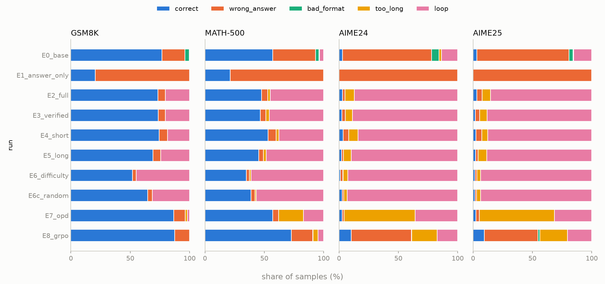

# Failure breakdown

Every eval sample gets exactly one category: **correct**; **wrong_answer** (finished, well formatted, wrong); **bad_format** (finished but `<think>` never closed, or no `\boxed{}`); **too_long** (hit the 16k cap while still making progress); **loop** (hit the cap repeating itself). **repetition** counts any trace with a >=30-char line repeated >= 5x (or a repeating tail), finished or not.

One annotated full trace per category: [failure_examples.md](failure_examples.md).

## GSM8K

| run | correct | wrong_answer | bad_format | too_long | loop | repetition |
|---|---|---|---|---|---|---|
| E0_base | 76.6 | 19.4 | 3.7 | 0.0 | 0.2 | 0.4 |
| E1_answer_only | 20.5 | 79.5 | 0.0 | 0.0 | 0.0 | 0.0 |
| E2_full | 73.3 | 6.2 | 0.0 | 0.0 | 20.5 | 21.7 |
| E3_verified | 73.5 | 6.1 | 0.0 | 0.1 | 20.3 | 21.8 |
| E4_short | 74.5 | 7.0 | 0.0 | 0.0 | 18.6 | 20.2 |
| E5_long | 69.1 | 6.4 | 0.0 | 0.2 | 24.3 | 27.3 |
| E6_difficulty | 52.0 | 3.0 | 0.0 | 0.1 | 44.9 | 46.6 |
| E6c_random | 64.7 | 3.9 | 0.0 | 0.1 | 31.4 | 32.8 |
| E7_opd | 86.7 | 9.5 | 0.0 | 2.0 | 1.7 | 3.5 |
| E8_grpo | 87.4 | 12.5 | 0.1 | 0.0 | 0.0 | 0.0 |

## MATH-500

| run | correct | wrong_answer | bad_format | too_long | loop | repetition |
|---|---|---|---|---|---|---|
| E0_base | 57.2 | 36.0 | 2.8 | 0.5 | 3.5 | 4.8 |
| E1_answer_only | 21.3 | 78.6 | 0.0 | 0.0 | 0.0 | 0.0 |
| E2_full | 47.8 | 5.1 | 0.0 | 2.1 | 45.1 | 48.7 |
| E3_verified | 46.6 | 4.7 | 0.0 | 2.8 | 45.9 | 49.6 |
| E4_short | 53.1 | 6.7 | 0.1 | 2.5 | 37.6 | 40.4 |
| E5_long | 45.5 | 3.9 | 0.1 | 2.4 | 48.3 | 52.2 |
| E6_difficulty | 34.8 | 2.6 | 0.0 | 1.4 | 61.2 | 63.5 |
| E6c_random | 38.9 | 3.4 | 0.0 | 1.1 | 56.8 | 59.4 |
| E7_opd | 57.2 | 4.9 | 0.1 | 20.7 | 17.1 | 22.1 |
| E8_grpo | 72.7 | 18.2 | 0.2 | 4.0 | 4.9 | 8.5 |

## AIME24

| run | correct | wrong_answer | bad_format | too_long | loop | repetition |
|---|---|---|---|---|---|---|
| E0_base | 2.9 | 75.2 | 6.2 | 2.1 | 13.5 | 16.5 |
| E1_answer_only | 0.2 | 99.8 | 0.0 | 0.0 | 0.0 | 0.0 |
| E2_full | 2.9 | 2.1 | 0.0 | 7.9 | 87.1 | 87.5 |
| E3_verified | 2.5 | 2.7 | 0.0 | 6.0 | 88.8 | 89.6 |
| E4_short | 3.5 | 4.6 | 0.0 | 7.9 | 84.0 | 84.8 |
| E5_long | 2.1 | 1.7 | 0.0 | 6.7 | 89.6 | 90.4 |
| E6_difficulty | 1.2 | 2.1 | 0.2 | 4.0 | 92.5 | 93.1 |
| E6c_random | 2.7 | 1.2 | 0.0 | 2.9 | 93.1 | 94.4 |
| E7_opd | 2.7 | 1.5 | 0.0 | 60.0 | 35.8 | 36.5 |
| E8_grpo | 10.2 | 50.8 | 0.2 | 21.5 | 17.3 | 30.8 |

## AIME25

| run | correct | wrong_answer | bad_format | too_long | loop | repetition |
|---|---|---|---|---|---|---|
| E0_base | 3.1 | 77.7 | 3.3 | 0.6 | 15.2 | 16.7 |
| E1_answer_only | 0.2 | 99.8 | 0.0 | 0.0 | 0.0 | 0.0 |
| E2_full | 3.3 | 4.4 | 0.0 | 7.1 | 85.2 | 85.6 |
| E3_verified | 1.9 | 3.8 | 0.0 | 6.2 | 88.1 | 89.4 |
| E4_short | 2.5 | 4.8 | 0.0 | 5.2 | 87.5 | 87.7 |
| E5_long | 2.1 | 2.1 | 0.0 | 7.5 | 88.3 | 89.2 |
| E6_difficulty | 1.7 | 1.5 | 0.0 | 3.3 | 93.5 | 93.8 |
| E6c_random | 1.7 | 1.2 | 0.0 | 3.3 | 93.8 | 94.0 |
| E7_opd | 2.5 | 2.7 | 0.0 | 63.3 | 31.5 | 31.9 |
| E8_grpo | 9.6 | 45.2 | 1.5 | 23.3 | 20.4 | 28.7 |

