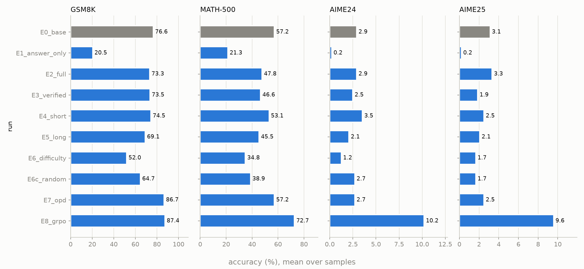
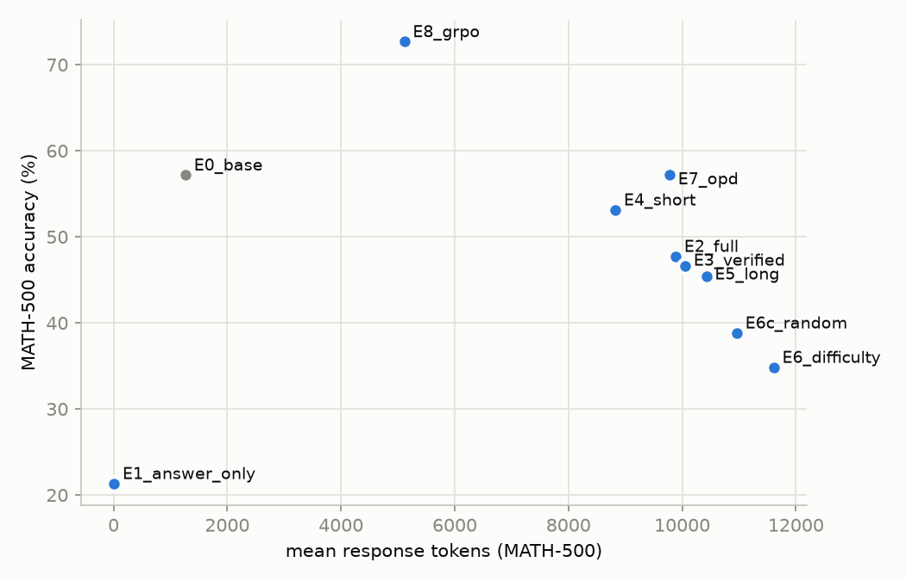
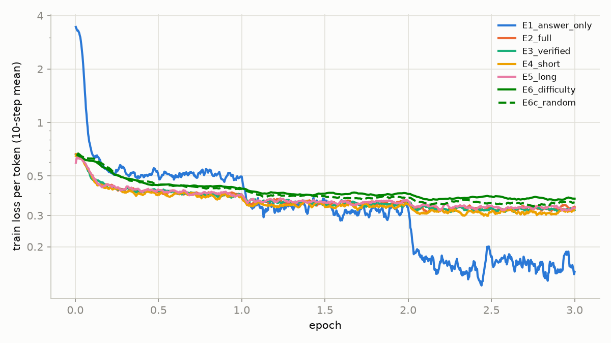

# Results

Accuracy = mean over all samples (pass@1). GSM8K n=1, MATH-500 n=4, AIME n=16 per problem.

| run | train n | GSM8K | MATH-500 | AIME24 | AIME25 | AIME24/25 pass@16 | MATH-500 tokens | MATH-500 truncated |
|---|---|---|---|---|---|---|---|---|
| E0_base | – | 76.6 | 57.2 | 2.9 | 3.1 | 16.7 / 23.3 | 1264 | 4.2% |
| E1_answer_only | 9498 | 20.5 | 21.3 | 0.2 | 0.2 | 3.3 / 3.3 | 9 | 0.0% |
| E2_full | 9377 | 73.3 | 47.8 | 2.9 | 3.3 | 20.0 / 13.3 | 9884 | 47.2% |
| E3_verified | 9127 | 73.5 | 46.6 | 2.5 | 1.9 | 16.7 / 13.3 | 10051 | 48.8% |
| E4_short | 9127 | 74.5 | 53.1 | 3.5 | 2.5 | 16.7 / 13.3 | 8824 | 40.1% |
| E5_long | 9127 | 69.1 | 45.5 | 2.1 | 2.1 | 13.3 / 16.7 | 10424 | 50.7% |
| E6_difficulty | 2553 | 52.0 | 34.8 | 1.2 | 1.7 | 10.0 / 10.0 | 11610 | 62.5% |
| E6c_random | 2553 | 64.7 | 38.9 | 2.7 | 1.7 | 16.7 / 13.3 | 10959 | 57.8% |
| E7_opd | – | 86.7 | 57.2 | 2.7 | 2.5 | 16.7 / 10.0 | 9776 | 37.9% |
| E8_grpo | – | 87.4 | 72.7 | 10.2 | 9.6 | 30.0 / 23.3 | 5113 | 8.8% |

